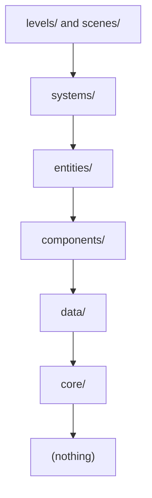

# Architecture

The folder structure (existing and planned), the layers, and the architectural rules. The detailed
complement to `AGENTS.md`.

## Philosophy

Whenever there's more than one valid option, choose the one **an agent or a human in a new session,
with no memory of earlier conversations, can understand fastest from the code and folders alone.**
That means low coupling with visible dependencies, small single-responsibility files and scenes, and
conventions predictable enough to infer.

## Folders that exist from setup

| Folder | Purpose |
|---|---|
| `.agents/` | Shared hooks, role workflows, hook tests, generated Codex skill mirrors |
| `.claude/` | Claude Code adapters, project skills, owner-managed settings |
| `.codex/` | Codex hook registration, config, agent definitions |
| `.github/` | CI, release and bug-intake workflows; the `setup-engine` action |
| `addons/` | Third-party Godot plugins (`gut/`), vendored and never edited |
| `core/` | Pure logic with no node or scene dependency; testable in isolation |
| `docs/` | GDD, architecture, ADRs, plans, status, history |
| `tests/` | `unit/` and `integration/`, mirroring the source tree |
| `tools/` | Development-only scripts and harnesses, never shipped |

## Folders created on demand

Create each one **with its first real file**, plus a short `README.md` (purpose, rules, current
state). Never pre-create them empty (ADR-0001).

| Folder | Purpose |
|---|---|
| `data/` | Typed `Resource` classes (schema) and `.tres` instances (data) |
| `components/` | Reusable nodes giving one behavior to whatever composes them |
| `entities/` | Scenes and scripts for concrete game objects, composed from components |
| `systems/` | Scene-scoped coordinators connecting several entities; never global |
| `scenes/` | Screens and shared scenes that are neither an entity nor a level |
| `levels/` | Playable stages that instance entities and systems |
| `autoload/` | Genuinely project-wide state only, each with an ADR |
| `assets/` | Imported art and audio, by type |

## Dependencies point down

A more generic layer never references a more concrete one. `core/` depends on nothing in the project.

## Rules

1. **GDScript is always typed** — variables, parameters, returns.
2. **Composition over inheritance** — shared behavior is a component, not a base class chain.
3. **Signals instead of direct coupling** — the owner of a relationship connects it; no long
   `get_node` paths between unrelated nodes.
4. **No global EventBus** (ADR-0005).
5. **Autoloads only for project-wide state**, each with an ADR.
6. **Small scenes, one responsibility each.**
7. **`Resource` for data** — tunables live in `.tres`, not constants.
8. **Reusable components, not copies.**
9. **Text scenes and resources** (ADR-0004); never edit `uid=` by hand.
10. **One `class_name` per file**, file name = class name in `snake_case`.

## Naming

Files and folders `snake_case`; classes and nodes `PascalCase`; constants `SCREAMING_SNAKE_CASE`;
signals past tense (`health_changed`); private members `_prefixed`; tests `<subject>_test.gd`.
