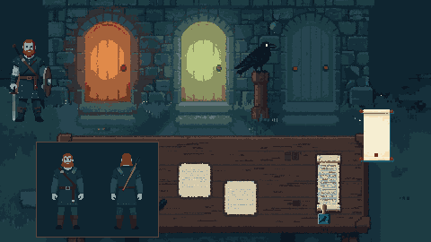

# Valhalla Intake — art direction

**Chosen:** 2026-10-21, direction "Fog & Bile" (owner's pick of three: Ash & Ember, Fog & Bile,
Carved Ink). **Frames:** `frames/` (game scale) and `frames/source/` (full-size generations, the
image references). **Palette:** `palette.gpl` (30 colours, grouped by meaning). **Lint:**
`pixelforge.toml` at the repository root.

## The style in one paragraph

Chunky limited-palette pixel art at dusk: dark teal and navy stone, low grey fog, cold moonlit
light, and two doors that glow, one ember and one bile, in an otherwise cold world. The routine at
the desk is calm. The unease comes from the dark around it and the light from the doors, never from
the evidence itself. What makes it recognisable: **everything is cold except the destinations**, so
the eye always knows where a soul could go, and the desk under them is lit plainly so the evidence
reads.

## Do

- Shade in bands: three or four tones per material, hard pixel edges, no anti-aliasing.
- Keep the desk and the slab plainly lit and fog-free. Mood lives in the gate band and the corners.
- Give the dead **ashen** skin (the Ashen ramp). The living never appear at the desk.
- Make every piece of evidence readable at 1:1 on the 480×270 screen. A wound gets Blood pixels
  where it enters; an object in the body (an arrow, a blade) gets a pale value against the dark
  tunic, as on `frames/body-chart.png`.
- Draw parchment warm off-white (Parchment ramp). Text on it is rendered by the engine, never
  painted.
- Pair every colour cue with a shape. Each realm door carries its own carved glyph: Valhalla a
  spear, Fólkvangr a boar, Hel a coiled serpent, Rán a wave. Threads differ by line pattern as well
  as colour (GDD §7). The frames don't show the glyphs yet; the first door asset adds them.
- Start every generation from the prompt core below, with the matching file in `frames/source/` as
  an image reference wherever the generator takes one.

## Don't

- No ember outside Valhalla's door, its light and UI accents (the wax seal, the selected thread).
  No bile outside Hel's door and its light. No blood outside wounds. `pixelforge.toml` reserves all
  three, so lint fails if they leak.
- No fog, glow or vignette crossing the slab, the body chart or the papers.
- No pure black: the darkest colour is Night 0.
- No dithering on characters or evidence. Banded shading only.
- No living skin tones on the dead. Generations often come back tan; recolour them to Ashen.

## References

| Reference | What it contributes |
|---|---|
| Dredge | Dusk palette, low fog, unease creeping into a cosy routine |
| Papers, Please | The desk split: the world in a band on top, the work on the desk below |
| Return of the Obra Dinn | The body read as evidence, laid out like a coroner's chart (ideas only) |
| Norwegian stave-church carving | Knotwork on wooden ends (scroll rods, the raven's post, door glyphs) |

## Sizes and canvases

The base resolution is 480×270, integer-scaled, with nearest filtering (`project.godot`). Canvases
are enforced by `pixelforge.toml`.

| Asset kind | Canvas (px) | Scale in game | Notes |
|---|---|---|---|
| Scene backdrop | 480×270 | 1:1 | Opaque. Gate band on top (~95 px), desk below |
| Soul, standing | 48×96 | 1:1 | The soul waiting at the gate, bottom-anchored |
| Body chart | 128×100 | 1:1 | Front and back side by side on the desk's left; 20-colour budget for evidence |
| Prop | 32×32 | 1:1 | Stamp, feather, trinkets; bottom-anchored |
| Law scroll | 80×150 | 1:1 or 2/3 | UI panel; the engine renders the decrees on it |
| UI marks under 32×32 | — | 1:1 | Never generated: placed pixel by pixel by a code-writing agent |

## Prompt core

These are the exact text and settings that produced the chosen frames. Every generation starts
from them.

- **Generator and model:** local ComfyUI 0.37, Z-Image Turbo
  (`z_image_turbo_int8_convrot.safetensors`, `qwen_3_4b_fp8_mixed.safetensors`, `ae.safetensors`),
  through the `comfyui-art` skill's `comfy.py`. No LoRA.
- **Settings:**
  - 8 steps, cfg 1.0, sampler `res_multistep`, scheduler `simple`, shift 3.0;
  - scenes at 1440×816, characters at 896×1152, body charts at 1152×896, props and UI at
    1024×1024;
  - seeds used: scene 33, soul 11, stamp 11, Law scroll 33, body chart 11.
- **Clean-up:**
  - **Opaque scenes:** keep the most common colour in each 3×3 block, then snap to `palette.gpl`
    (redmean) without keying.
  - **Sprites:** `pixel_post.py key`, then `pixelforge clean --canvas <kind>`.
  - **Then fix colours by meaning:** Ashen skin, Hair instead of Blood on heads, reserved ramps out
    of the wrong places.
- **Prompt core** (appended to every prompt):

  > Pixel art, chunky pixels, soft banded shading with three or four tones per material, no
  > anti-aliasing. A deep dusk palette of dark teal, navy and slate blue, thin pale grey fog bands
  > drifting low, cold moonlit blue light; a single ember orange glow is the only warm colour.
  > Quiet, uneasy, creeping dread.

  For sprites and UI, drop "thin pale grey fog bands drifting low": the model paints fog into the
  sprite's background.

- **Per-kind additions** (put before the core):
  - **Scene:**
    - Describe the frame as "the main screen of a desk game, one full-bleed image with plain
      unmarked corners, split into two horizontal bands".
    - The gate wall goes in the top third, seen straight on.
    - The desk fills the bottom two thirds, "seen from directly above".
  - **Character (a soul):**
    - Say what is visible, with no backstory: "one dead Viking warrior standing alone, full body,
      centred, feet near the bottom, front view".
    - Describe the skin as "ashen grey-blue and bloodless".
    - Name each wound with its place and say "clearly visible".
    - End with "Plain flat solid pure magenta background, completely empty, no other figures, no
      ground, no shadow".
    - Never write "queue": the model draws a crowd.
  - **Body chart:** "a coroner's chart of one dead Viking warrior: the same man shown twice side
    by side at the same size, on the left seen from the front, on the right seen from behind…",
    then say which view shows each wound and that the other view shows none.
  - **Prop:** the object alone, "centred, occupying the middle half of the frame", on the magenta
    background.
  - **UI:**
    - Use "warm off-white parchment, faintly yellowed like old paper" and empty ruled lines.
    - Keep the knotwork on wooden ends only.
    - Use the magenta background.

The exact full prompts for each frame are recorded in the pull request that added this guide.
